<div align="center">
  
</div>

<div align="center">
  
  
  
</div>

## about

Things I do, not in my past time but to pass time. Two small Tkinter desktop apps.

| file | what it does |
|:--|:--|
| `stopwatch/Fun_watch.py` | Start, stop, reset. Hours, minutes, seconds. |
| `image-fun/image_viewer.py` | Pick an image through the file dialog and show it. |

## run

```bash
pip install -r requirements.txt
python stopwatch/Fun_watch.py
python image-fun/image_viewer.py
```

---

<div align="center">
  <sub>Part of <a href="https://github.com/Madmins07">Madmins07</a> · Madhav Agarwal · IIT Kharagpur</sub>
</div>
